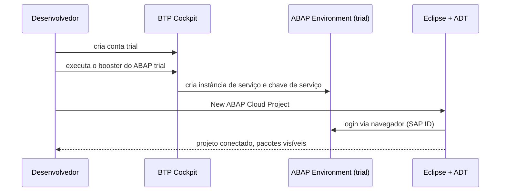

# SAP BTP ABAP Environment - Study

> Nível: prática
> Primeiro contato com o ABAP Cloud: instância trial, acesso pelo ADT, pacote e classe executável.
> Relacionados: [SAP-BTP-devops-study](https://github.com/igor-barral/SAP-BTP-devops-study),
> [ABAP-Development-Tools-devops-study](https://github.com/igor-barral/ABAP-Development-Tools-devops-study),
> [abapGit-devops-study](https://github.com/igor-barral/abapGit-devops-study), [ABAP-language-study](https://github.com/igor-barral/ABAP-language-study).

## Objetivo

O **SAP BTP ABAP Environment** é um sistema ABAP gerenciado pela SAP dentro do BTP. Nele só existe o
modelo de desenvolvimento **ABAP Cloud**: linguagem restrita (*ABAP for Cloud Development*), apenas
APIs e objetos **liberados** (*released*) pela SAP, e desenvolvimento no ADT. É o lugar gratuito
(via trial) para aprender ABAP moderno, CDS e RAP, que são o mesmo modelo usado hoje dentro do
S/4HANA Cloud e nas extensões *clean core* do S/4HANA on-premise.

Este repositório contém a primeira classe do roadmap, `ZCL_IB_HELLO_WORLD`, e documenta como chegar
até ela.

Ao concluir este estudo você deverá ser capaz de responder perguntas como:

- Como se obtém e se acessa uma instância do ABAP Environment no trial?
- O que é uma classe executável (`IF_OO_ADT_CLASSRUN`) e como ela substitui o "report de teste"?
- Qual a diferença entre ABAP Cloud e ABAP clássico no mesmo sistema?
- O que o trial permite e o que não permite?
- Quando usar o SAP ABAP Platform Trial (Docker) em vez do BTP trial?

## Ponte

| O que eu já conheço | No ABAP Environment |
|---|---|
| `public static void main(String[] args)` em Java / `static void Main` em C# | Método `if_oo_adt_classrun~main`, executado com F9 no ADT |
| `System.out.println` / `Console.WriteLine` | `out->write( ... )` no console do ADT |
| Projeto/pacote Maven, namespace C# | **Pacote** ABAP (`ZIB_BTP_ABAP_ENV`), que também define o transporte |
| Servidor remoto onde o código vive e compila | O próprio sistema ABAP: o código é salvo e ativado no servidor, não no disco local |
| Allowlist de APIs de uma plataforma (ex.: sandbox do Salesforce) | APIs **liberadas** do ABAP Cloud (contrato C1 e outros) |
| PHP rodando com `disable_functions` restrito | ABAP Cloud: comandos e objetos não liberados geram erro de sintaxe |

A mudança maior para quem vem de PHP/C#: **não há arquivo local como fonte da verdade**. O código
fica no servidor ABAP, com versão ativa e inativa; o Git entra depois, via abapGit.

## Conteúdo

### 1. Da conta trial ao ADT



1. Na conta trial ([SAP-BTP-devops-study](https://github.com/igor-barral/SAP-BTP-devops-study)), execute o *booster* de
   preparação do ABAP Environment trial. Ele cria a instância e uma **chave de serviço** (JSON com
   URL e dados de conexão do sistema).
2. No Eclipse com ADT instalado ([ABAP-Development-Tools-devops-study](https://github.com/igor-barral/ABAP-Development-Tools-devops-study)),
   crie um **ABAP Cloud Project** (*File > New > Other > ABAP Cloud Project*). Informe a chave de
   serviço ou a URL do sistema, conforme o assistente pedir.
3. O login é feito no navegador com o seu usuário SAP. Ao final, o projeto aparece no
   *Project Explorer* com o nó do sistema.

As telas do assistente mudam entre versões do ADT; siga o tutorial oficial citado nas referências
se algum passo estiver diferente.

### 2. Pacote

Todo objeto ABAP pertence a um pacote. No trial compartilhado use um pacote próprio abaixo de
`ZLOCAL` ou crie `ZIB_BTP_ABAP_ENV` (o nome precisa ser único no sistema, que é compartilhado).

- *Right click* no projeto > *New > ABAP Package*.
- Nome: `ZIB_BTP_ABAP_ENV`, descrição e, no trial, o superpacote `ZLOCAL` (o assistente e o
  tutorial oficial indicam o que o sistema aceita).
- Pacotes em `ZLOCAL` são locais (sem transporte). Em ambiente de cliente, o pacote fica num
  componente de software transportável.

### 3. A classe executável

[`src/zcl_ib_hello_world.clas.abap`](src/zcl_ib_hello_world.clas.abap):

```abap
CLASS zcl_ib_hello_world DEFINITION
  PUBLIC
  FINAL
  CREATE PUBLIC.

  PUBLIC SECTION.
    INTERFACES if_oo_adt_classrun.

  PRIVATE SECTION.
    METHODS build_greeting
      IMPORTING user_name       TYPE string
      RETURNING VALUE(greeting) TYPE string.
ENDCLASS.

CLASS zcl_ib_hello_world IMPLEMENTATION.

  METHOD if_oo_adt_classrun~main.
    DATA(user_name) = CONV string( cl_abap_context_info=>get_user_technical_name( ) ).
    DATA(today) = cl_abap_context_info=>get_system_date( ).

    out->write( build_greeting( user_name ) ).
    out->write( |Data do sistema: { today DATE = ISO }| ).
    out->write( |Timestamp UTC: { utclong_current( ) TIMESTAMP = ISO }| ).
  ENDMETHOD.

  METHOD build_greeting.
    greeting = |Hello World, { user_name }! ...|.
  ENDMETHOD.

ENDCLASS.
```

Pontos de leitura:

- **`DEFINITION` e `IMPLEMENTATION` separados**: como um header C++ e seu `.cpp`, no mesmo arquivo.
- **`INTERFACES if_oo_adt_classrun`**: a interface liberada que torna a classe executável no ADT.
  O método `main` recebe `out`, um objeto com o método `write` que aceita textos, estruturas e
  tabelas internas e mostra tudo no console.
- **`cl_abap_context_info`**: API liberada para usuário, data e fuso do contexto. No ABAP Cloud
  prefira essas APIs a campos de sistema como `sy-uname` e `sy-datum`.
- **`utclong_current( )`**: função embutida que devolve um timestamp UTC (tipo `utclong`).
- **String template** `|...{ expressão }...|`: interpolação, com opções de formatação como
  `DATE = ISO`. Aprofundado em [ABAP-language-study](https://github.com/igor-barral/ABAP-language-study).

Execução: abrir a classe e pressionar **F9** (*Run As > ABAP Application (Console)*). A saída vai
para a view *Console* do Eclipse.

### 4. ABAP Cloud e ABAP clássico

| Aspecto | ABAP clássico (*Standard ABAP*) | ABAP Cloud (*ABAP for Cloud Development*) |
|---|---|---|
| Onde existe | ECC, S/4HANA on-premise e Private Edition | BTP ABAP Environment, S/4HANA Cloud Public Edition, e também S/4HANA on-premise/Private Edition em versões recentes, para pacotes marcados com essa versão de linguagem |
| Linguagem | Completa, incluindo comandos de tela (`WRITE`, `SELECTION-SCREEN`, dynpro) | Subconjunto moderno; comandos de UI clássica e obsoletos são proibidos |
| Objetos SAP acessíveis | Qualquer tabela, função ou classe do sistema | Apenas objetos liberados (ex.: views CDS `I_...` liberadas, classes com contrato de uso) |
| UI | SAP GUI, dynpro, Web Dynpro, Fiori | Fiori/SAPUI5 sobre serviços RAP/OData |
| Ferramenta | SAP GUI (SE80, SE38...) e ADT | Apenas ADT |
| Extensão do padrão | Modificações, *user exits*, BAdIs clássicas | APIs liberadas, BAdIs liberadas, RAP (*clean core*) |

No **mesmo sistema S/4HANA** os dois modelos convivem: a **versão de linguagem ABAP** é atribuída
por objeto/pacote (e pelo componente de software). Um pacote em ABAP Cloud só enxerga objetos
liberados; um pacote clássico ao lado continua podendo usar tudo. No BTP ABAP Environment só existe
ABAP Cloud.

Para ver quais objetos SAP estão liberados, use no ADT o nó *Released Objects* do projeto no
*Project Explorer* (ou a view *Properties* do objeto, aba *API State*). O verificador de sintaxe acusa o uso de objeto não
liberado.

### 5. O que o trial permite e o que não permite

Permite:

- Criar pacotes, classes, interfaces, tabelas, CDS, BDEF e serviços RAP.
- Executar classes no console, rodar ABAP Unit e publicar serviços OData para testar com o preview
  do Fiori Elements.
- Clonar e publicar repositórios com abapGit (ver [abapGit-devops-study](https://github.com/igor-barral/abapGit-devops-study)).

Não permite (ou limita):

- **Sistema compartilhado**: sem acesso administrativo, sem ver objetos de outros usuários fora do
  que for público; nomes precisam ser únicos.
- **Nada de ABAP clássico**: sem SAP GUI, sem reports com `WRITE`, sem dynpro, sem transações SE80,
  SE38, SM37 etc.
- **Não há dados de negócio de um S/4HANA** (pedidos, clientes reais): o ABAP Environment não é um
  ERP. Para estudar tabelas como `VBAK` ou `EKKO`, use o ABAP Platform Trial.
- **Prazo e limpeza**: a instância trial pode ser removida ou recriada; mantenha o código no GitHub.

### 6. SAP ABAP Platform Trial (Docker), para a fase 7

Para o ABAP clássico (reports, SAP GUI, BAPI, BAdI clássica) a SAP distribui uma imagem Docker do
**ABAP Platform Trial**, `sapse/abap-cloud-developer-trial` no Docker Hub. Pontos práticos:

- Exige muita memória RAM e disco; verifique os requisitos na página da imagem antes de tentar.
- É um sistema completo on-premise, com SAP GUI, ADT e dados de exemplo; licença de avaliação
  renovável conforme instruções da SAP.
- O comando `docker run` exato, as portas e a renovação de licença estão na página da imagem e no
  blog de lançamento da SAP Community (buscar "ABAP Platform Trial").

Este repositório **não** usa essa imagem; o Docker aqui serve apenas para rodar o abaplint.

## Respostas

**Como se obtém e se acessa uma instância do ABAP Environment no trial?**
Criando a conta BTP trial, executando o *booster* do ABAP trial no cockpit (que cria a instância e
a chave de serviço) e criando no Eclipse um *ABAP Cloud Project* com essa chave ou URL. O login é
feito no navegador com o usuário SAP.

**O que é uma classe executável e como ela substitui o "report de teste"?**
É uma classe global que implementa `IF_OO_ADT_CLASSRUN`. O método `main` é chamado pelo ADT com F9
e escreve no console via `out->write`. No ABAP clássico, o equivalente seria um report (`REPORT` +
`WRITE`), que não existe no ABAP Cloud.

**Qual a diferença entre ABAP Cloud e ABAP clássico no mesmo sistema?**
No S/4HANA os dois convivem, separados pela versão de linguagem atribuída a cada pacote/objeto. O
ABAP Cloud só permite a sintaxe moderna e objetos liberados, e é editado apenas no ADT; o clássico
permite tudo, inclusive acesso direto a qualquer tabela e UI SAP GUI. O ABAP Cloud é o que garante
um *clean core*: extensões que não quebram em upgrades.

**O que o trial permite e o que não permite?**
Permite todo o desenvolvimento ABAP Cloud (classes, CDS, RAP, OData, ABAP Unit, abapGit). Não
permite ABAP clássico nem SAP GUI, não tem dados de ERP, é compartilhado e tem prazo.

**Quando usar o ABAP Platform Trial em vez do BTP trial?**
Quando o tema exige ABAP clássico ou tabelas de ERP: reports, dynpro, BAPI, BAdI clássica,
debugger na SAP GUI, SE80. Para ABAP Cloud, CDS e RAP, o BTP trial basta e é mais leve.

## Como rodar

### Verificação local (sem sistema SAP)

```bash
docker compose run --rm abaplint
```

O contêiner `node:20-alpine` baixa o `@abaplint/cli` e as dependências de
https://github.com/abaplint/deps (para reconhecer `IF_OO_ADT_CLASSRUN`) e verifica o código com
`"version": "Cloud"` em [`abaplint.json`](abaplint.json). Resultado esperado:
`abaplint: 0 issue(s) found`. O serviço usa a rede `bridge` padrão do Docker para não criar uma
rede nova a cada execução.

### Execução real

1. BTP ABAP Environment trial, projeto ABAP Cloud aberto no ADT.
2. Criar o pacote `ZIB_BTP_ABAP_ENV` (componente `ZLOCAL` no trial).
3. Importar este repositório pelo abapGit (view *abapGit Repositories* > *Link New abapGit
   Repository*, URL do GitHub, pacote `ZIB_BTP_ABAP_ENV`) e fazer *Pull*. Detalhes em
   [abapGit-devops-study](https://github.com/igor-barral/abapGit-devops-study).
4. Ativar os objetos (Ctrl+Shift+F3), abrir `ZCL_IB_HELLO_WORLD` e pressionar **F9**.

Estrutura:

```
.abapgit.xml                          configuração do abapGit (pasta src/, lógica PREFIX)
abaplint.json                         regras do abaplint (ABAP Cloud)
docker-compose.yml                    serviço abaplint
src/package.devc.xml                  pacote ZIB_BTP_ABAP_ENV
src/zcl_ib_hello_world.clas.abap      código da classe
src/zcl_ib_hello_world.clas.xml       metadados da classe (descrição, idioma)
```

## Referências

- SAP Help Portal, "SAP BTP, ABAP Environment": https://help.sap.com (buscar "ABAP Environment"
  e "Released Objects").
- SAP Developer tutorials: https://developers.sap.com (buscar "Create an SAP BTP ABAP Environment
  Trial User" e "Create Your First Console Application").
- SAP Learning: https://learning.sap.com (buscar "Acquiring Core ABAP Skills" e "ABAP Cloud").
- ABAP Keyword Documentation, seção ABAP for Cloud Development: https://help.sap.com (buscar
  "ABAP Keyword Documentation").
- SAP Community, ABAP Platform Trial: https://community.sap.com (buscar "ABAP Platform Trial").
- abaplint: https://abaplint.org
